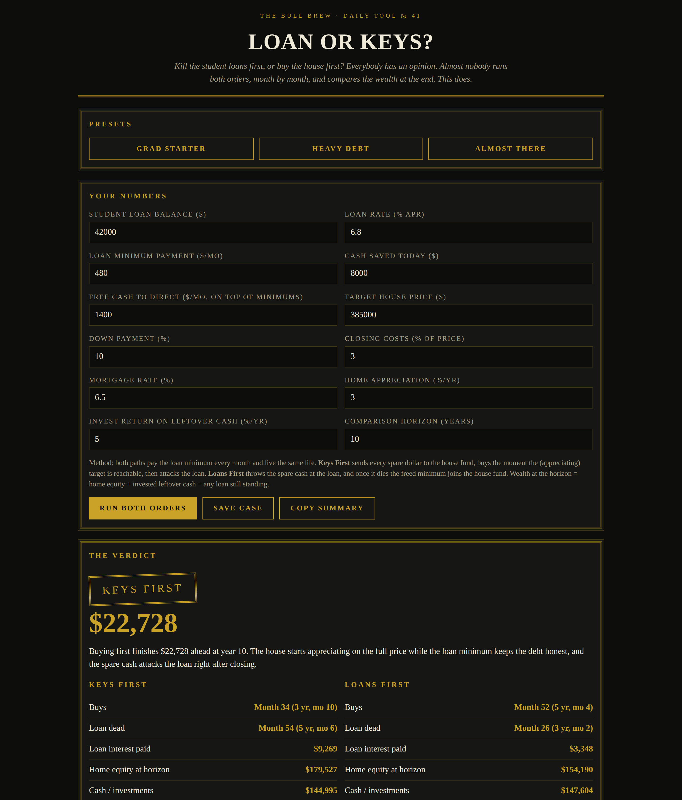

# Loan or Keys? — The Student Loan vs House Verdict

**Live:** https://thebullbrew.github.io/loan-or-keys/
**Repo:** https://github.com/thebullbrew/loan-or-keys

## What it does
Kill the student loans first, or buy the house first? This tool runs both orders month by month on the same life and judges them on one honest number: wealth at the horizon. Both paths pay the loan minimum every month. **Keys First** sends every spare dollar to the house fund, buys the moment the appreciating target is reachable, then attacks the loan. **Loans First** throws the spare cash at the loan, and once it dies the freed minimum joins the house fund.

You get KEYS FIRST / LOANS FIRST / CLOSE CALL seals (a gap under $7,500 over a decade is called a tie — pick the order your nerves prefer), when each path buys, when the loan dies under each, total loan interest paid, home equity, leftover cash, a wealth-anatomy bar, and a sensitivity table showing how the winner flips as your monthly free cash changes. Three presets, saveable cases in your browser, and a copyable summary.

## The method behind it
The target is a moving one: the down payment plus closing is priced on the house price *as it appreciates while you save*, not today's price — that single detail is why "save first" math in most calculators is too kind. After purchase, the mortgage amortizes on a real schedule and leftover cash is invested at your stated return. Wealth = home equity + invested cash − any loan still standing. Caveats are stated in the app: taxes, PMI, escrow, and peace of mind are not in the model.

## Design
Dark aesthetic variation 3 — Brass & Ink: near-black ground, brass accents, double-rule art-deco borders, letterspaced cap eyebrows, oversized serif numerals.

## How to run
Open `docs/index.html` in any browser, or serve the `docs/` folder with any static host. Works offline as a PWA after first load. No backend, no accounts, nothing leaves your browser.
